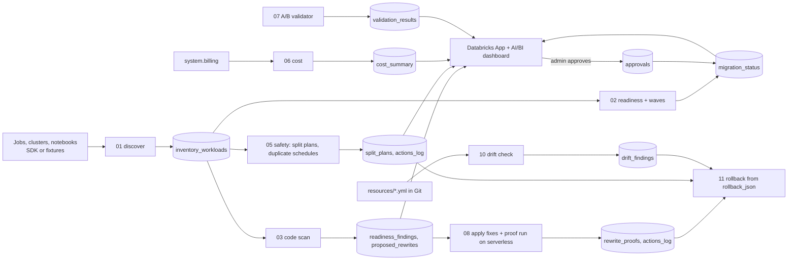

# Serverless Migration Tracker

A fleet-level tracker for Databricks classic-to-serverless migration. The `/compute migrate to serverless` agent moves
**one** notebook or job at a time. This project is the programme around it: it inventories every job, notebook and
cluster, scores readiness, lists the blockers per workload, plans waves, gates approval, checks that migrated output
is correct, and compares DBUs and cost before and after, in one app and one dashboard.

**It tracks, plans and verifies; it does not migrate.** Moving a workload is done by the agent or by hand. The tracker
tells you what to move first, what is blocked and why, and whether the result can be trusted.

## What it covers

| ID | Limitation | What is built | Depth |
|---|---|---|---|
| L1 | No fleet view, progress or approval | Inventory, readiness score, waves, admin approval gate, status workflow, Databricks App and AI/BI dashboard | Full |
| L2 | Jobs over 10 tasks | Split plan (child jobs plus a paused orchestrator), checked against the original, stored in `split_plans` and shown task by task in the Fixes tab. `apply_splits=true` creates the jobs for approved jobs | Automated, see gaps |
| L3 | Init scripts | Detected; the script is translated into the job's serverless `environments` block (pip packages) with a manual follow-up list (OS packages, env vars, other commands). Shown before / after in the Fixes tab | Detect + translate (sample script) |
| L4 | ML runtime, custom image, DBR below 13, instance profiles | Detected from cluster specs, fix path in each finding | Detect |
| L5 | Eggs, JARs, Maven | Detected per job and task, with the wheel / volume / PyPI path | Detect |
| L6 | cache, checkpoint, global temp views, mounts | Static scan; automated rewrites, proven by rescanning (`auto_fixable`), shown as a diff per notebook, **applied as new notebook copies** (`08_apply_fixes`), and **proven on serverless**: the original example fails, the rewrite succeeds | Automated rewrite, applied and proven |
| L7 | Scala and R | Detected and classified: PySpark/SQL rewrite effort or keep on classic | Classify |
| L8 | No output verification | A/B diff of the classic and serverless output tables with pass or fail, per-row reasons, status workflow | Automated |
| L9 | Bundle / Git drift | `10_drift` compares every job in `resources/*.yml` with the deployed job: schedule, trigger, timeout, tags, notifications, and per task the notebook, parameters, dependencies and compute (classic cluster added = drift). `enforce=true` reverts top-level drift to Git and stores the undo; `11_rollback` undoes any logged change | Automated (top level), report (tasks) |
| L10 | Duplicate schedules | Detected; `enforce=true` pauses the extra trigger and stores the undo settings | Automated, see gaps |
| L11 | Log delivery, SSH keys, mounts | Inventoried and reported as "lost on serverless" | Detect |
| L12 | Cost not tracked | DBUs and list cost per run before vs after, by job and team tag, from `system.billing` | Automated |
| L13 | Silent behaviour changes | Missing stream triggers and ANSI-risky SQL detected, with `try_cast` / `availableNow` rewrites, applied and proven together with L6 | Automated rewrite, applied and proven |


## Architecture



* All state is Delta tables in one Unity Catalog schema (default `workspace.serverless_migration`).
* Jobs are plain notebooks, deployed as an Asset Bundle; logic lives in `src/tracker/` as pure Python and is unit-tested.
* The App reads through a SQL warehouse as its service principal and writes only `approvals` and `migration_status`.
  The approver is the signed-in user, checked as workspace admin; without that it is read-only.
* Planning is the default everywhere. Anything that changes the workspace (`enforce`, `apply_splits`, `update_status`)
  is opt-in, admin-only, restricted to approved jobs, and logged to `actions_log`.

### Readiness and waves

Score is 100 minus weighted findings. Wave 1: no blockers. Wave 2: every blocker has an automated fix. Wave 3: manual
work. Wave 4: needs an owner decision (ML runtime, custom image, Scala or R). Only classic jobs in wave 1 or 2 can enter
the approval gate.

## Deploy

Needs the Databricks CLI, a profile for your workspace, Unity Catalog, and a SQL warehouse.
The bundle looks up a warehouse named "Serverless Starter Warehouse"; if yours is named differently add
`--var="warehouse_id=<id>"` to the commands below. No workspace URL is stored in the repo.

```
databricks bundle validate -p <profile>
databricks bundle deploy   -p <profile>
databricks bundle run setup_state_tables    -p <profile>   # creates the tables
databricks bundle run pipeline              -p <profile>   # discover, scan, safety, readiness
databricks bundle run cost                  -p <profile>   # cost comparison (sample billing by default)
databricks bundle run validate              -p <profile>   # A/B validation demo
databricks bundle run migration_tracker_app -p <profile>   # start the app
databricks bundle run grant_app             -p <profile>   # give the app SELECT, MODIFY on 2 tables, add you as approver
databricks bundle run apply_fixes           -p <profile>   # write rewritten copies + prove original fails / rewrite runs
databricks bundle run drift                 -p <profile>   # Git vs workspace drift report
databricks bundle run rollback              -p <profile>   # list what can be undone (dry run)
```

## Fixes, shown on examples

The app's **Fixes** tab shows each automated fix on a concrete example:

1. **Proof run (L6, L13).** `fixtures/notebooks/runnable_demo.py` uses `checkpoint()`, a global temp view and an ANSI
   `CAST` on bad input. `08_apply_fixes` runs it on serverless as written (fails) and as rewritten (succeeds), and
   shows the diff.
2. **Rewrites per notebook.** A line-by-line diff for every scanned notebook, and the new copy written to
   `/Shared/serverless_migration_demo/<name>_serverless`. The original notebook is never edited.
3. **Init script (L3).** The script next to the generated serverless `environments` block.
4. **Split (L2).** The 12-task job as two child jobs of 10 and 2 tasks plus a paused orchestrator.
5. **Scala and R (L7).** Keep on classic or rewrite, with the effort and reasons.

## Drift and rollback (L9)

To see it: edit the `[tracker] cost comparison` job in the UI (add a schedule, or change a parameter), run
`databricks bundle run drift`, and open the **Drift & rollback** tab. Run the drift job with `enforce=true` to put the
schedule back to Git; the change is logged with its undo. Run `rollback` with `action_id=latest` and `dry_run=false`
to undo it. Task-level drift (parameters, a task moved to a classic cluster) is reported and fixed by
`databricks bundle deploy`.

## Who can approve

The app allows decisions only for a user it can confirm: with Databricks Apps user authorization, the user's own token
must show workspace admin; otherwise the signed-in email (set by the Apps proxy) must be in the `approvers` table, which
only a workspace admin fills by running `grant_app`. Everyone else is read-only. The `04_approve` notebook is the same
gate for notebook users.

Then open the app (Compute, Apps) and the dashboard "[tracker] Serverless migration progress".
After changing app code, run `migration_tracker_app` again to redeploy it.

Variables (`databricks.yml`): `catalog`, `schema`, `discovery_mode` (FIXTURE or LIVE), `cost_source` (SAMPLE or SYSTEM),
`warehouse_id`. If you change catalog or schema, also change them in `src/app.yaml`.

### Modes

* **FIXTURE** (default): reads sample jobs, clusters and notebooks from `fixtures/`, so everything runs on a workspace
  with no classic compute (such as Free Edition).
* **LIVE**: reads the real workspace through the SDK. Secret-looking values are removed before anything is stored.
* **Cost SAMPLE** uses made-up billing rows and prices; **SYSTEM** reads `system.billing.usage`.

### Preview without a workspace

```
pip install streamlit pandas databricks-sdk
cd src && set TRACKER_LOCAL=1 && streamlit run app/main.py
```

## A/B validation (L8)

`databricks bundle run validate` runs a demo: one comparison that passes (float noise and a load timestamp are
tolerated) and one that fails (a changed value, a NULL, a missing row, an extra row). For a real migration, run the
original job and the migrated clone so they write two tables, then run the `[tracker] A/B validation` job with
"Run now with different parameters": `mode=TABLES`, `workload_id`, `classic_table`, `serverless_table`, `key_columns`,
`ignore_columns`, and `update_status=true` (admin only). An approved job then moves to `DONE` when every table passes,
or to `ROLLED_BACK` (not promoted) when one fails. Jobs that were never approved are never changed.

Row counts alone are not enough: in the demo the failing run has 200 rows on both sides (one missing, one extra).

## Tests

```
pip install pytest duckdb
pytest -q
```

124 tests cover inventory, readiness, scanning and rewrites, waves and approvals, splitting, schedules, cost,
the app's data layer, the validator, fix rendering, drift comparison and rollback. The validator's SQL is run on DuckDB, a real engine, for pass, changed value,
missing and extra rows, NULL vs value, duplicate keys and keyless comparison.

## Known gaps

* **Free Edition has no classic compute.** The demo runs in FIXTURE mode, and the A/B demo creates both sides on
  serverless with seeded differences. LIVE discovery, `enforce`, `apply_splits` and a real classic-vs-serverless
  validation are implemented but were **not** run against real classic workloads.
* **L9 drift covers this bundle's jobs.** It compares the deployed jobs with `resources/*.yml`; it does not write a
  migrated job's new config back to Git. Task-level drift is reported, not auto-reverted (redeploy the bundle).
  If you deploy with `--var` overrides other than catalog, schema, discovery_mode and cost_source, pass them to the
  drift job too, or they show as parameter drift.
* **Rollback replays what the tracker stored.** It undoes the tracker's own changes (pause, drift revert, split jobs,
  notebook copies), not changes made by the migration agent or by hand.
* **Rewrites are applied as copies.** The rewritten notebook is written next to a demo folder; switching the job to
  the copy is a manual step after validation. The proof run uses one sample notebook; the other fixture notebooks
  read tables that do not exist on a fresh workspace.
* **L3** translation is shown on a sample script; fetching real scripts from S3 or DBFS needs cloud access and is not built.
* The validator compares outputs; it does not start the classic and serverless runs itself.
* `MIGRATING` and `VALIDATING` are not set automatically, because the tracker does not perform the migration.
* `cost_source=SYSTEM` was not verified against production billing, and prices are list prices, not contract rates.
* The dashboard file is hand-written JSON. It renders on Free Edition; other workspaces were not tried.
* Free Edition allows one app per account. Without Apps user authorization, approval relies on the `approvers` table.

## Next

Point a job at the rewritten copy after validation; write a migrated job's config back to the bundle; run the A/B validator from a clone job;
verify `system.billing` mode on a paid workspace; Lakebase for approvals if row-level concurrency matters.

## Credits

Built with AI assistance (allowed by the challenge rules). No third-party code is included.
